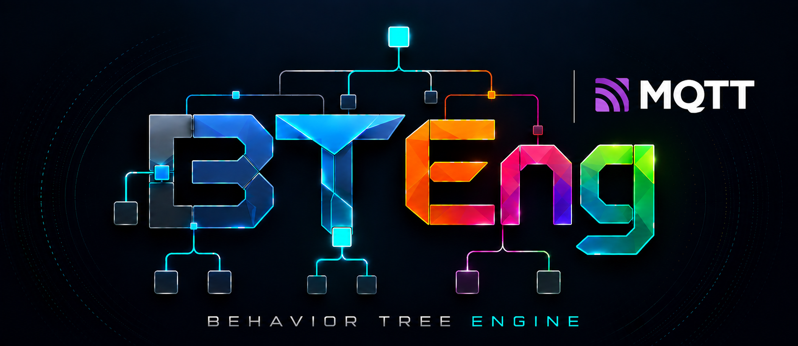

<p align="center">
  
</p>

# bteng-mqtt

MQTT integration for the [BTEng](https://github.com/BTEng-dev/bteng) Behavior Tree engine, for behavior-tree-based messaging in distributed automation and robotics.

- Behavior-tree nodes that publish, subscribe, and react to broker traffic
- A project needs only a topic registry and tree XML, with no Python to write
- Same contract as [bteng-opcua](https://github.com/BTEng-dev/bteng-opcua): same registry idea, same `run` command, same blackboard plumbing

## Requirements

- Python 3.12+
- [bteng](https://github.com/BTEng-dev/bteng) >= 0.3.2
- [paho-mqtt](https://github.com/eclipse-paho/paho.mqtt.python) >= 2.0
- PyYAML >= 6.0
- An MQTT broker for live runs. If you cannot install mosquitto, `pip install amqtt` provides one that does not need root.

## Installation

```bash
pip install bteng-mqtt
```

## Quick start

A project is a registry and one or more trees:

```
project/
├── config/mqtt_config.yaml   # broker settings + topic aliases
└── trees/main_flow.xml       # the behavior tree
```

```xml
<BTEng format_version="1.0" main_tree_to_execute="main">
  <Tree ID="main">
    <Sequence name="ConveyorFlow">
      <MqttConnect      name="Connect"    client_id="main" host="127.0.0.1" port="1883" />
      <MqttPublish      name="Start"      client_id="main" topic_alias="conveyor_cmd" value="start" />
      <MqttWaitForValue name="Running"    client_id="main" topic_alias="robot_state"
                        expected_value="running" timeout="10.0" />
      <MqttDisconnect   name="Disconnect" client_id="main" />
    </Sequence>
  </Tree>
</BTEng>
```

```bash
bteng-mqtt run trees/ -n config/mqtt_config.yaml
```

## Nodes

| Node | Purpose |
|---|---|
| `MqttConnect` / `MqttDisconnect` / `MqttReconnect` | Connection lifecycle; broker settings come from the registry |
| `MqttPublish` / `MqttBatchPublish` | Publish one or many topics; QoS 1/2 wait for the acknowledgement |
| `MqttSubscribe` / `MqttUnsubscribe` | Wait for a message or a specific value; `persistent` keeps the subscription |
| `MqttWaitForValue` | Wait until a topic satisfies `eq`/`ne`/`gt`/`lt`/`ge`/`le`/`contains` |
| `MqttCondition` | Synchronous check of the last value received; never blocks |
| `MqttBatchRead` | Copy several topics' latest values to the blackboard |
| `MqttRequestResponse` | Request/reply topic pair, the `OpcUaCallMethod` analog |
| `Sleep` | Timed wait, identical to the node in `bteng-opcua` |

## Commands

```bash
bteng-mqtt run trees/ -n config/mqtt_config.yaml                       # run every tree
bteng-mqtt run trees/pick.xml -n config/mqtt_config.yaml --bb speed=1.5
bteng-mqtt discover -s config/discover.yaml -o config/mqtt_config.yaml # draft topics from live traffic
bteng-mqtt discover -s config/discover.yaml -o config/mqtt_config.yaml --check
bteng-mqtt monitor -n config/mqtt_config.yaml -a temperature           # tail decoded topics
```

> **`discover` is a sniff, not a harvest.** MQTT has no information model, so a quiet topic is invisible and every payload type is a guess from the samples that arrived. Review the generated file before trusting it.

## Try it

From a clone of the [repository](https://github.com/BTEng-dev/bteng-mqtt), with a broker on `127.0.0.1:1883`:

```bash
bteng-mqtt run examples/trees/ -n examples/config/mqtt_config.yaml
```

`request_response_tree.xml` also needs `examples/demo_responder.py` running.

## Documentation

- [Topic registry](https://github.com/BTEng-dev/bteng-mqtt/blob/main/docs/topic-registry.md): every field of the registry, with examples
- [Discovery](https://github.com/BTEng-dev/bteng-mqtt/blob/main/docs/discovery.md): `discover` and `monitor`, and how far to trust a sniff
- [Authoring nodes](https://github.com/BTEng-dev/bteng-mqtt/blob/main/docs/authoring-nodes.md): writing your own MQTT node
- [Design](https://github.com/BTEng-dev/bteng-mqtt/blob/main/docs/design.md): architecture and milestones
- [Changelog](https://github.com/BTEng-dev/bteng-mqtt/blob/main/CHANGELOG.md)

## Development

```bash
pip install -e ".[dev]"
pytest tests/
```

Tests marked `broker` need a live MQTT broker (`BTENG_MQTT_BROKER`, default `127.0.0.1:1883`) and skip when none is listening.

## License

[MIT](https://github.com/BTEng-dev/bteng-mqtt/blob/main/LICENSE)
